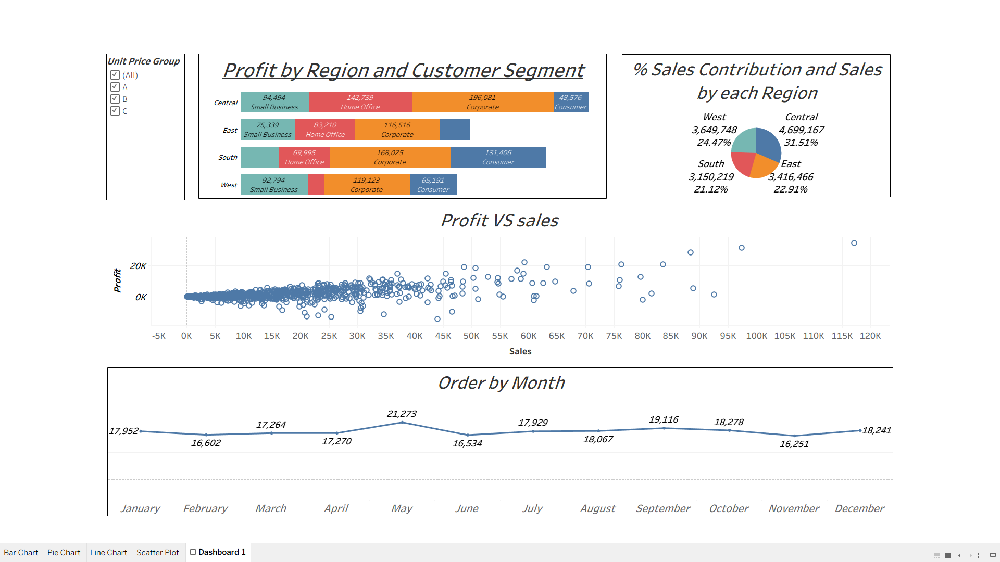

# Tableau Sales Analysis Dashboard

## 📊 Project Overview

This project is a **Sales Analysis Dashboard** built using Tableau to analyze sales performance, profitability, regional distribution, and order trends using the Sample Superstore Sales dataset.

## 🎯 Objectives

- Analyze profit across regions and customer segments.
- Understand order quantity trends over time.
- Compare sales contribution across regions.
- Explore the relationship between sales and profit.
- Build an interactive dashboard for business analysis.

## 🖼️ Dashboard Preview

### Dashboard Overview



## 🛠️ Tools & Technologies

- Tableau Desktop
- Microsoft Excel
- GitHub

## 📂 Dataset

The project uses the Sample Superstore Sales dataset in Excel format.

The dataset includes information about:

- Orders and order dates
- Sales, profit, and discounts
- Customers and customer segments
- Regions, cities, and states
- Product categories and sub-categories
- Shipping modes and order quantities

## 📈 Dashboard Visualizations

### 1. Bar Chart — Profit by Region and Customer Segment

Compares profitability across regions and customer segments.

### 2. Line Chart — Order Trends

Visualizes order quantity over time to identify trends and patterns.

### 3. Pie Chart — Sales by Region

Shows the relative contribution of different regions to total sales.

### 4. Scatter Plot — Sales vs. Profit

Explores the relationship between sales and profit.

## 🔍 Key Business Questions

1. How does profit vary across regions and customer segments?
2. How do order quantities change over time?
3. Which regions contribute to overall sales?
4. What is the relationship between sales and profit?
5. How can Tableau help identify business trends?

## 🚀 How to Run the Project

1. Download or clone this repository.
2. Install Tableau Desktop.
3. Open `Tableau-Dashboard-1.twb`.
4. If prompted, reconnect the workbook to `Sample+-+Superstore+Sales.xls`.
5. Open the dashboard and explore the visualizations.

## 📁 Project Structure

```text
Tableau-Sales-Analysis/
├── Tableau-Dashboard-1.twb
├── Sample+-+Superstore+Sales.xls
└── README.md  
